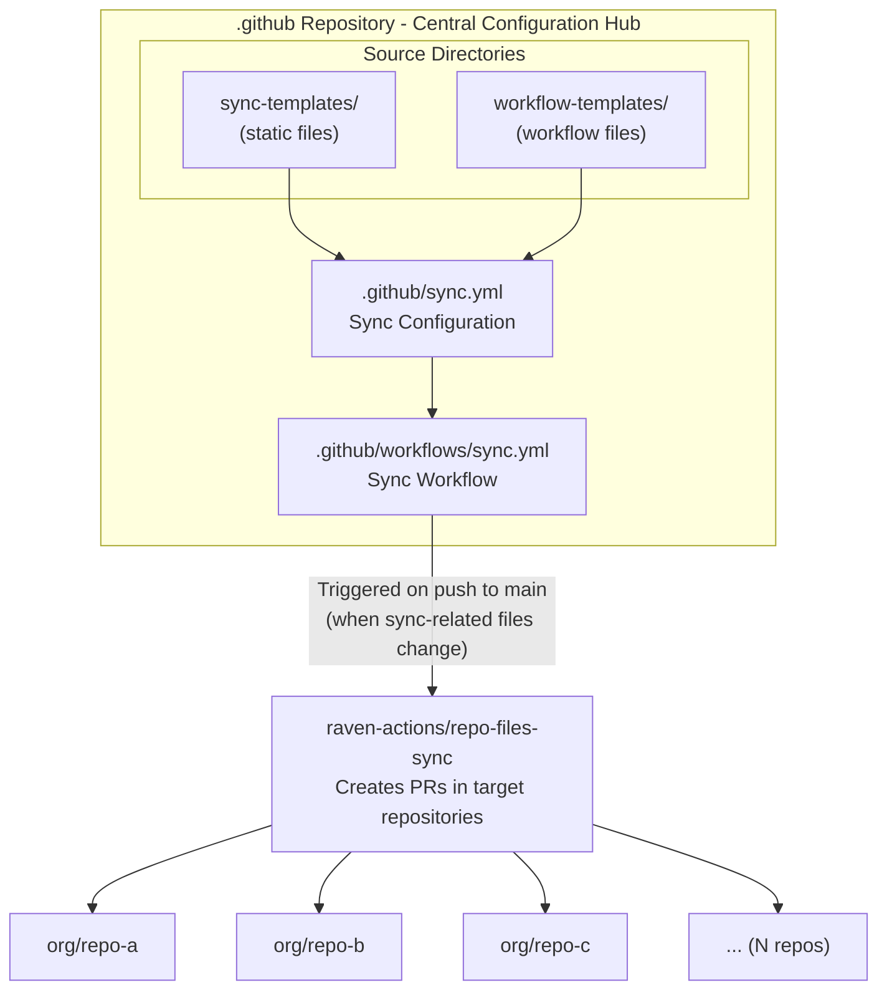
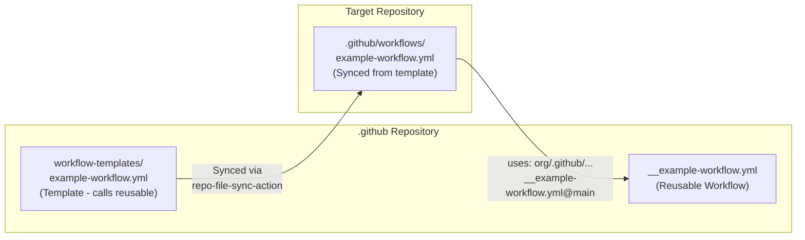

# Repository Files Sync

This document describes the centralized file synchronization used across the `radius-project` organization to maintain consistency and governance standards across all repositories.

## Table of Contents

- [Table of Contents](#table-of-contents)
- [Overview](#overview)
  - [Key Benefits](#key-benefits)
- [Architecture](#architecture)
- [Directory Structure](#directory-structure)
- [How Sync Works](#how-sync-works)
  - [Trigger Conditions](#trigger-conditions)
  - [Sync Process](#sync-process)
  - [Authentication](#authentication)
- [Configuration Files](#configuration-files)
  - [`.github/sync.yml` - Sync Configuration](#githubsyncyml---sync-configuration)
- [Sync Templates](#sync-templates)
- [Workflow Templates](#workflow-templates)
  - [1. GitHub Workflow Templates (UI)](#1-github-workflow-templates-ui)
  - [2. Synced Workflows](#2-synced-workflows)
  - [Example Templates](#example-templates)
- [Reusable Workflows](#reusable-workflows)
  - [Naming Convention: `__` Prefix](#naming-convention-__-prefix)
  - [Examples](#examples)
  - [Workflow Relationship Diagram](#workflow-relationship-diagram)
  - [Usage Pattern](#usage-pattern)
  - [PR Author Assignment (Radius PoC)](#pr-author-assignment-radius-poc)
  - [PR Status Labels](#pr-status-labels)
  - [Labels](#labels)
  - [Signed Release Upmerge](#signed-release-upmerge)
  - [Release Backports](#release-backports)
- [Adding New Files to Sync](#adding-new-files-to-sync)
  - [Step 1: Add the Source File](#step-1-add-the-source-file)
  - [Step 2: Update Sync Configuration](#step-2-update-sync-configuration)
  - [Step 3: Commit and Push](#step-3-commit-and-push)
- [Target Repositories](#target-repositories)
- [Troubleshooting](#troubleshooting)
  - [Sync Not Triggering](#sync-not-triggering)
  - [PRs Not Created](#prs-not-created)
  - [File Not Appearing in Target Repo](#file-not-appearing-in-target-repo)
  - [Merge Conflicts](#merge-conflicts)
- [References](#references)

---

## Overview

The `.github` repository serves as the **Single Source of Truth** (SSoT) for organization-wide configurations, templates, and policies. It uses an automated synchronization to distribute common files (such as licenses, linter configs, workflows, etc) to all repositories in the `radius-project` organization.

### Key Benefits

- 🔄 **Consistency**: Ensures all repositories follow the same standards
- 🛡️ **Governance**: Centralized control over critical files like LICENSE
- ⚡ **Automation**: Changes automatically propagate via Pull Requests
- 📝 **Audit Trail**: All changes are tracked through Git history and PRs

---

## Architecture



---

## Directory Structure

```text
.github/
├── .github/                             # GitHub-specific configurations for THIS repo
│   ├── sync.yml                         # ⚙️ SYNC CONFIGURATION FILE
│   ├── actions/                         # Shared actions used by reusable workflows
│   └── workflows/
│       ├── sync.yml                     # ⚙️ SYNC WORKFLOW
│       └── __<workflow-name>.yml        # Reusable workflows (prefixed with __)
│
├── sync-templates/                      # 📁 Static files and nunjucks templates to sync
│   ├── <static-file>                    # Files synced as-is (no transformation)
│   └── <template-file>.njk              # Nunjucks templates (rendered before sync)
│
├── workflow-templates/                  # 📁 GitHub Actions workflow templates
│   ├── README.md                        # Documentation for workflow templates
│   ├── <template-name>.yml              # Workflow template file
│   └── <template-name>.properties.json  # Template metadata
│
└── eng/                                 # 📁 Engineering documentation
    └── SYNC.md                          # This file
```

---

## How Sync Works

### Trigger Conditions

The sync workflow (`.github/workflows/sync.yml`) is triggered when:

1. Code is pushed to the `main` branch
1. **AND** changes are made to any of these paths:
   - `.github/workflows/sync.yml` (the workflow itself)
   - `.github/sync.yml` (sync configuration)
   - `.github/actions/release-backport/**` (shared helpers also used locally by Radius)
   - `sync-templates/**` (any file in sync-templates)
   - `workflow-templates/*.yaml` or `workflow-templates/*.yml`

### Sync Process

1. **Checkout**: The workflow checks out the `.github` repository
1. **Authentication**: Obtains a GitHub App token with permissions for:
   - `metadata: read`
   - `contents: write`
   - `pull-requests: write`
   - `workflows: write`
1. **Bot Identity**: Retrieves bot details for commit attribution
1. **File Sync**: Uses [raven-actions/repo-files-sync](https://github.com/raven-actions/repo-files-sync) to:
   - Read the sync configuration from `.github/sync.yml`
   - Create branches (prefixed with `repo-sync`) in target repos
   - Copy files from source to destination paths
   - Open Pull Requests with commit messages prefixed with `chore:`

### Authentication

The sync uses a **GitHub App** for authentication (configured via secrets):

- `FILES_SYNC_BOT_APP_ID`: The GitHub App ID
- `FILES_SYNC_BOT_PRIVATE_KEY`: The GitHub App private key

This approach provides:

- Fine-grained permissions
- Better audit trails
- No dependency on personal access tokens

---

## Configuration Files

### `.github/sync.yml` - Sync Configuration

This is the heart of the sync. It defines:

- **Target repositories** (in the `repos` section)
- **File mappings** (source → destination)

```yaml
group:
  repos: |
    radius-project/.github
    radius-project/repo-a
    radius-project/repo-b@custom-branch   # Can specify different branches
    # ... more repos

  files:
    - source: sync-templates/LICENSE
      dest: LICENSE

    - source: sync-templates/.gitattributes
      dest: .gitattributes

    - source: workflow-templates/<template-name>.yml
      dest: .github/workflows/<template-name>.yml
```

**Key Features:**

- Uses [nunjucks templating](https://mozilla.github.io/nunjucks/templating.html) for advanced configurations
- Supports branch specification with `@branch` syntax
- Supports directory patterns and exclusions

---

## Sync Templates

The `sync-templates/` directory contains files that are synchronized **as-is** to target repositories. These are static files that should be identical across all repositories in the organization.

**Common use cases:**

- License files (e.g., `LICENSE`)
- Editor configuration files (e.g., `.editorconfig`)
- Git configuration files (e.g., `.gitattributes`)
- Code of conduct, contributing guidelines
- Any other file that should be standardized across repositories

Files placed in this directory are copied directly to the destination path specified in the sync configuration, without any transformation or templating.

---

## Workflow Templates

Files in `workflow-templates/` serve **two purposes**:

### 1. GitHub Workflow Templates (UI)

When developers create new workflows in any organization repository, they see these templates in the GitHub Actions UI. Each template requires:

- `<template-name>.yml` - The workflow file
- `<template-name>.properties.json` - Metadata (name, description, icon, categories)

**Example properties file:**

```json
{
  "name": "Example Workflow",
  "description": "Description of what this workflow does.",
  "iconName": "icon-name",
  "categories": ["category-1", "category-2"],
  "filePatterns": []
}
```

### 2. Synced Workflows

The same workflow files are synced to repositories via the sync, ensuring all repos have the workflow automatically.

### Example Templates

| Template                | Description                               |
|-------------------------|-------------------------------------------|
| `dependency-review.yml` | Scans PR dependencies for vulnerabilities |
| `lint.yml`              | Runs linting checks on code changes       |
| `ci.yml`                | Continuous integration workflow           |

---

## Reusable Workflows

### Naming Convention: `__` Prefix

Files in `.github/workflows/` that are intended to be **reusable workflows** (callable by other repositories) **MUST** be prefixed with double underscores (`__`).

**Why this convention?**

- 🔍 **Visual Distinction**: Easily identify which workflows are reusable vs. internal
- 📂 **Sorting**: `__` prefixed files appear at the top of directory listings
- 🔒 **Safety**: Prevents accidental modification of shared workflows
- 📖 **Documentation**: Self-documenting naming convention

**Naming pattern:** `__<workflow-name>.yml`

### Examples

| Workflow                  | Description                                   |
|---------------------------|-----------------------------------------------|
| `__dependency-review.yml` | Runs dependency scanning with standard config |
| `__lint.yml`              | Shared linting workflow                       |
| `__build.yml`             | Shared build workflow                         |
| `__pr-author.yml`         | Assigns unassigned human PRs to their author  |
| `__pr-status-labels.yml`  | Applies PR lifecycle labels                   |
| `__pr-holds.yml`          | Fails when a PR carries a manual hold label   |
| `__labels.yml`            | Applies a repository's synced labels file     |
| `__upmerge.yml`           | Creates signed release-to-edge net-diff PRs    |

### Workflow Relationship Diagram



### Usage Pattern

Target repositories call reusable workflows instead of duplicating logic:

```yaml
# In target repository (synced from workflow-templates/)
jobs:
  example-job:
    uses: radius-project/.github/.github/workflows/__example-workflow.yml@main
    permissions:
      contents: read
      pull-requests: write
```

### PR Author Assignment (Radius PoC)

PR author assignment is maintained in [the reusable master workflow](../.github/workflows/__pr-author.yml) and exposed through [a thin caller template](../workflow-templates/pr-author.yml). Its matching `pr-author.properties.json` metadata makes the template discoverable in the organization's GitHub Actions UI without automatically enrolling other repositories.

On `opened` and `reopened`, the workflow assigns a human author only when the live PR is open and has no assignees. Bot-authored, closed, and already-assigned PRs are skipped. Existing assignees are never replaced. API errors and ignored assignment requests fail the run instead of silently succeeding.

The caller uses `pull_request_target` to support fork PRs. This automation is **metadata-only**: never add PR checkout, PR code execution, or untrusted PR artifacts. The caller and master grant only `pull-requests: write`, and no custom secrets are required. The externally sourced action is pinned to a full commit SHA.

The dedicated PR-author group in `.github/sync.yml` initially enrolls **only `radius-project/radius`**. After the central change merges into `main`, the existing Sync workflow opens a downstream PR that adds `.github/workflows/pr-author.yml` to Radius. Merge that sync PR to activate the workflow. Other repositories, including `.github` itself, are not automatically enrolled. Existing open PRs are not backfilled; the workflow handles new or reopened PRs after activation.

To expand the rollout later, add approved repository names to the dedicated PR-author group rather than adding this mapping to the all-repository group. The caller follows the existing organization convention of referencing `__pr-author.yml@main`, so shared logic updates reach enrolled repositories without copying the implementation.

### PR Status Labels

PR lifecycle labeling is maintained in [the PR Status Labels action](../.github/actions/pr-status-labels/README.md) and [its reusable workflow](../.github/workflows/__pr-status-labels.yml), which loads the action from the same commit with the `$/` self-repository syntax. Three thin caller templates are synced together: [`pr-status-labels.yml`](../workflow-templates/pr-status-labels.yml), the read-only [`pr-review-signal.yml`](../workflow-templates/pr-review-signal.yml) relay, and [`labels.yml`](../workflow-templates/labels.yml), which applies the repository's centrally managed `.github/labels.yml` (see [Labels](#labels)).

The dedicated PR status labels group in `.github/sync.yml` enrolls **`radius-project/.github`, `ai-extensions`, `dashboard`, `docs@edge`, `lab`, `radius`, `recipes`, `resource-types-contrib`, and `website`**. Add a repository to that group only after its own lifecycle-label workflows are removed, so only one writer updates its labels. See [Opting a repository in](../.github/actions/pr-status-labels/README.md#opting-a-repository-in).

`docs` is synced to `edge`, which is not its default branch. PRs into `edge` are labeled as soon as the sync pull request merges, but scheduled reconciliation, review-triggered updates, and the label sync run only from the default branch, so they start once the next release branch is cut from `edge`. See [Limitations](../.github/actions/pr-status-labels/README.md#limitations).

The release-impact check (`PR Required Labels`) is Radius-only and is not part of this group.

### Labels

Label definitions are managed only in this repository and synced to `.github/labels.yml` in every repository of the PR status labels group:

- [`sync-templates/.github/labels.yml.njk`](../sync-templates/.github/labels.yml.njk) defines the shared labels, currently the PR lifecycle and manual hold labels.
- The `repo_labels` template variable of that group in `.github/sync.yml` adds repository-specific labels, keyed by repository name. The template header documents the label options. List a newly enrolled repository's existing `pr:` labels there unchanged so the sync does not alter them.

Repositories must not edit their synced `.github/labels.yml`; change the template or `repo_labels` instead, and the Sync workflow opens a pull request with the rendered file. When that pull request merges, the synced `Labels` workflow applies the file with `skip-delete`, so labels the file does not list are preserved. The workflow also reverts manual edits to the labels the file defines. Renaming lifecycle labels through the `PR_STATUS_LABELS` variable needs matching definitions in `repo_labels`, each with `from_name` set to the old name. See [Label catalog](../.github/actions/pr-status-labels/README.md#label-catalog).

### Signed Release Upmerge

Release upmerge logic lives inline in [`__upmerge.yml`](../.github/workflows/__upmerge.yml). Only the thin native [docs caller](../workflow-templates/upmerge-docs.yml) and [samples caller](../workflow-templates/upmerge-samples.yml) are synced as-is, to **`.github/workflows/upmerge.yaml`**; the release coordinator depends on that filename and the inner step name **`Create pull request`**. The shared implementation is not copied into consumer repositories.

The dedicated mappings in `.github/sync.yml` enroll only **`radius-project/docs@edge`** and **`radius-project/samples@edge`**. Each caller passes the `preserve-paths` input directly: docs preserves `docs/config.toml` and `docs/layouts/partials/hooks/body-end.html`; samples preserves `bicepconfig.json`. Manage those input values in the native caller YAML here, not in the synced caller downstream.

| Caller parameter | Contract |
| --- | --- |
| `preserve-paths` input | Required newline-delimited list of literal repository-relative file paths. Use `/` separators; blank lines and CRLF lists are accepted. Absolute paths, traversal, `.git` components, backslashes, pathspec prefixes and directories are rejected. Files retain their edge state, including absence or deletion. |
| `RADIUS_RELEASE_BOT_CLIENT_ID` secret | Required release GitHub App client ID, passed explicitly by the caller. |
| `RADIUS_RELEASE_BOT_PRIVATE_KEY` secret | Required release GitHub App private key, passed explicitly by the caller. |

Callers expose only `workflow_dispatch` and grant the reusable job `contents: read`. The App installation must already have Contents, Pull requests and Workflows write access to the caller repository. Its short-lived token is scoped to that repository only; it needs no installation on `.github`. No new grants or secrets are provisioned by the workflow.

The workflow uses the caller's repository, ref and immutable `github.sha`, checks out edge, and prepares a native Git squash without importing source ancestry. The pinned create-pull-request action publishes one App-signed net-diff commit with an explicit App DCO trailer. Only the preparation step receives a committer identity; the signing action's author and committer are not overridden. The native `pull-request-commits-verified` output and returned PR details must confirm publication.

A clean merge preserves both branches' changes and opens a **ready-for-review** PR. Conflicts confined to preserved files are resolved using edge's state without discarding other merged content. Other content conflicts stop the run and list the affected files in its log and summary; no draft or provisional source snapshot is published. Resolve the conflicting changes on the source or edge branch through normal review, then retry. A rerun retains the original source SHA, so a source-branch fix requires a new workflow run; an edge fix can be picked up by a rerun. Unrelated Git failures also stop the run. A genuine no-op **skips `Create pull request`**, so the coordinator does not discover an old or empty PR. Review and branch rules still apply.

Callers follow the organization's `@main` convention: new runs receive shared logic updates without another caller sync. The source commit still comes from the caller's recorded execution. [GitHub's rerun rules](https://docs.github.com/en/actions/reference/workflows-and-actions/reusing-workflow-configurations#behavior-of-reusable-workflows-when-re-running-jobs) distinguish rerunning failed/specific jobs, which reuse the original shared commit, from rerunning all jobs, which resolves `@main` again. Historical inline runs do not adopt the new caller by retrying; recorded release receipts are not rewritten.

Initial rollout, while both consumer defaults are `v0.61`:

1. Merge the shared `.github` change into `main` first, after its read-only checks pass.
1. Bootstrap the same native callers into `v0.61` through [radius-project/docs#2058](https://github.com/radius-project/docs/pull/2058) and [radius-project/samples#2705](https://github.com/radius-project/samples/pull/2705), removing the duplicated local implementations in those consumer PRs.
1. Review and merge the normal Sync PRs delivering callers to `edge`. Ongoing caller updates stay enrolled only on edge; future release branches inherit them when cut. Do not add permanent sync mappings for old release branches.

### Release Backports

[`__release-backport.yml`](../.github/workflows/__release-backport.yml) and the [Release Backport action](../.github/actions/release-backport/action.yml) maintain the shared implementation. The reusable workflow loads the action with `$/`, keeping its scripts at the same commit as the workflow. Only the native [`release-backport.yml` caller](../workflow-templates/release-backport.yml) is synced to `.github/workflows/release-backport.yaml` in **`radius`, `bicep-types-aws`, `dashboard`, and `recipes`**.

These repositories develop on `main`, squash-merge source PRs, and selectively backport to existing `release/X.Y` branches. This does not enroll docs or samples: their current `vX.Y`-to-`edge` upmerge process is different. A repository using this backport model can be enrolled by adding it to the dedicated sync group; do not change the generic caller per repository.

Apply `backport release/X.Y` to a PR merged into that repository's `main`. Labels may also be applied before merge. The workflow selects pending sources in main's first-parent merge order and opens one backport PR per channel at a time. Rebase-merge the reviewed backport to preserve its source title and exact cherry-pick trailer; the release-branch push starts the next queued item. Already-included source commits and verified merged backports are skipped. No branch is created, no backport is merged automatically, and closing a backport without resolving its existing automation branch requires manual reconciliation.

To reconcile an existing queue from the Actions UI, run `release-backport` on `main` with `channel` in `X.Y` format. For example:

```bash
gh workflow run release-backport.yaml --repo radius-project/recipes --ref main -f channel=0.62
```

This processes the same labeled queue; it does not select unmerged PRs or infer which fixes belong in a release. Ordinary successful backports are ready for review. A conflicting backport remains a draft containing only a handoff document on the unchanged release base, not a provisional source snapshot. Follow its exact recovery commands before marking it ready.

Each caller must have access to `RADIUS_RELEASE_BOT_CLIENT_ID` and `RADIUS_RELEASE_BOT_PRIVATE_KEY`, either as repository secrets or approved organization secrets. The App needs Contents, Workflows, Issues, and Pull requests write access on each enrolled repository; its token is scoped to that repository only. GitHub's job token needs only Contents, Issues, and Pull requests read. The workflow checks out trusted `main`, never a PR head, and executes the centrally maintained action. Backports retain the existing Radius source-author and DCO contract rather than replacing the author with the App for cryptographic signing. They are not the App-signed upmerge commits described above.

Merge this shared implementation first, then review the normal Sync PRs in the four repositories. Create each supported channel's `backport release/X.Y` label if absent and allow rebase merges on `release/*`. Existing release branches also need the thin caller before their push events can advance the queue: label the merged caller-sync PR for those channels and merge its generated backports, or reconcile the channel manually from `main` until that bootstrap completes. New release branches inherit the caller; do not add permanent version-specific sync mappings. Retain Radius's required release-branch provenance check and all normal review rules.

The three helper scripts are also synced back to Radius's `.github/scripts/` because release preparation and local checks consume them there. Their source of truth is [the shared action directory](../.github/actions/release-backport/), not the synced copies. Existing action CI exercises the JavaScript queue logic; these are script behavior checks, not workflow-YAML or caller-render tests.

---

## Adding New Files to Sync

### Step 1: Add the Source File

Place the file in the appropriate directory:

- **Static files** (LICENSE, configs) → `sync-templates/`
- **Workflows** → `workflow-templates/`

### Step 2: Update Sync Configuration

Edit `.github/sync.yml` to add the new file mapping:

```yaml
files:
  # Existing files...

  - source: sync-templates/NEW_FILE
    dest: NEW_FILE
```

### Step 3: Commit and Push

Push to `main` branch. The sync workflow will automatically:

1. Detect the change
1. Create PRs in all target repositories

---

## Target Repositories

The sync targets repositories defined in `.github/sync.yml`. Example structure:

| Repository                    | Branch   | Notes                        |
|-------------------------------|----------|------------------------------|
| `radius-project/.github`      | main     | This repository (self-sync)  |
| `radius-project/main-project` | main     | Main project repository      |
| `radius-project/docs`         | **edge** | Custom branch example        |
| `radius-project/website`      | main     |                              |
| `radius-project/samples`      | **edge** | Custom branch example        |
| ...                           | ...      | Add all repositories to sync |

> **Note:** Use `@branch` syntax in `sync.yml` to specify non-default branches (e.g., `radius-project/docs@edge`).

---

## Troubleshooting

### Sync Not Triggering

1. Verify you pushed to `main` branch
1. Check that changed files match the path filters in `sync.yml`
1. Review Actions tab for workflow runs

### PRs Not Created

1. Check GitHub App permissions
1. Verify secrets `FILES_SYNC_BOT_APP_ID` and `FILES_SYNC_BOT_PRIVATE_KEY` are set
1. Review sync workflow logs for errors

### File Not Appearing in Target Repo

1. Verify file mapping in `.github/sync.yml`
1. Check if the file already exists (sync may skip or require manual merge)
1. Look for open PRs from the sync bot

### Merge Conflicts

The sync action creates PRs, not direct commits. If conflicts occur:

1. Review the PR in the target repository
1. Resolve conflicts manually
1. Merge the PR

---

## References

- [raven-actions/repo-files-sync](https://github.com/raven-actions/repo-files-sync) - The sync action used
- [Creating workflow templates](https://docs.github.com/en/actions/how-tos/reuse-automations/create-workflow-templates) - GitHub docs
- [Reusable workflows](https://docs.github.com/en/actions/using-workflows/reusing-workflows) - GitHub docs
- [GitHub Apps](https://docs.github.com/en/apps/creating-github-apps/about-creating-github-apps/about-creating-github-apps) - Authentication method
